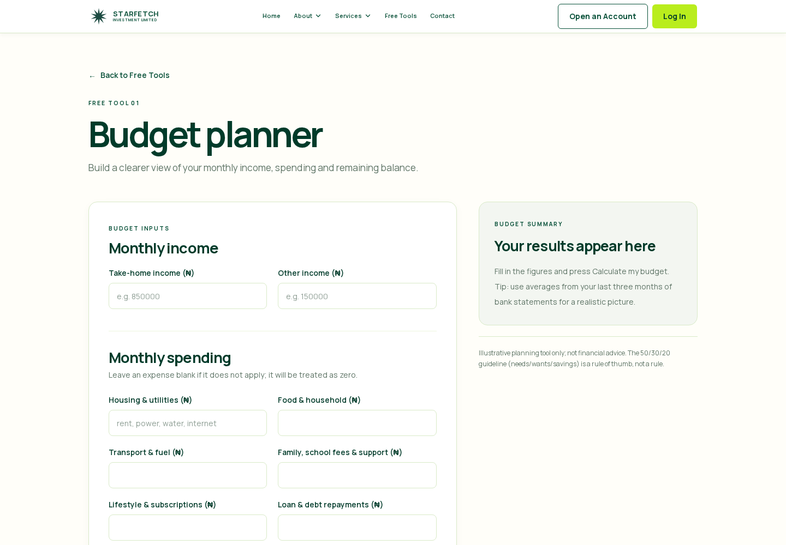
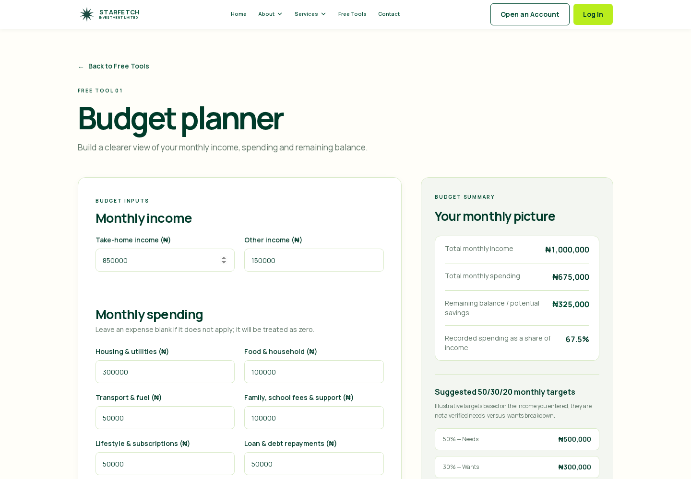

# Budget Planner — Completion Report

**Status:** Complete and verified locally in a production Next.js build.

## Delivered

- Added the public **Budget Planner** at `/tools/budget`.
- Updated only the **Budget Planner** card on `/tools` to use a local Next `Link` to `/tools/budget`.
- Left Portfolio Allocation Tool and Returns Calculator honestly unavailable; neither was implemented or redirected elsewhere.
- Preserved the shared Starfetch Navbar, Footer, local Free Tools navigation, typography and green palette.
- Built a responsive planner with a white input card and pale-grey results panel side by side at 1024px/1440px, stacking at 768px and below.
- Added all requested monthly income and seven monthly spending fields in the requested order, including the requested labels and placeholders.
- Added accessible field errors, form-level unsafe-total error handling, preserved input values, zero/blank expense handling, and a local-only `Calculate my budget` action.
- Added initial-state guidance, calculated income/spending/balance or shortfall, zero-income-safe percentage handling, and clearly illustrative 50/30/20 amounts without classifying the broad expense inputs as needs or wants.
- Added the exact required disclaimer beneath the results panel.
- Uses integer kobo values for parsing, aggregation and display, avoiding floating-point currency display errors.

## Local-only and privacy safeguards

- The planner component makes no API calls, writes no local/session storage or cookies, sends no analytics, logs no financial values, and has no save/email/account feature.
- The shared auth provider now suppresses its otherwise global session-refresh request **only while `/tools/budget` is open**. This makes a direct Budget Planner load entirely network-free with respect to `/api`; non-Budget routes retain their current session-refresh behavior.
- No backend, API contract, database/Prisma, authentication service, environment, deployment, Git, or remote repository changes were made.

## Verification

| Check | Result |
| --- | --- |
| `npm run typecheck` | Passed |
| `npm run build` | Passed; `/tools/budget` statically generated |
| `npm run test:budget-planner` | Passed |
| Existing Free Tools, Footer, Privacy, Complaints, auth-navigation and Joint regression checks | Passed |
| Production preview route smoke test for `/tools` and `/tools/budget` | HTTP 200 |
| Production-browser direct Budget Planner load | No `/api` request observed |
| Production-browser calculation action | No API request and no local/session-storage change observed |
| Existing non-Budget auth behavior | Browser-verified that `/login` still initializes its existing auth refresh request |
| Responsive production-browser checks | Passed at 1440, 1024, 768, 390 and 320 pixels with no horizontal overflow |
| Local navigation | Browser-verified `/tools` card → `/tools/budget` and Back to Free Tools → `/tools` |

### Calculation cases verified in the production browser

- Primary case: ₦850,000 + ₦150,000 income and ₦675,000 spending produced ₦1,000,000 total income, ₦325,000 balance, 67.5% spending, and ₦500,000/₦300,000/₦200,000 illustrative targets.
- Recalculation updated the display to ₦775,000 spending and ₦225,000 balance after changing Food & household.
- Income-only case, monthly shortfall case, zero-income percentage case, two-decimal case, and a maximum safe amount case all passed.
- Negative input received an accessible field error.
- An unsafe combined total received an accessible form error and no financial result was shown.

## Browser screenshots

### Before calculation

### After calculation

Screenshot files are also available at:

- `artifacts/budget-planner-before.png`
- `artifacts/budget-planner-after.png`
