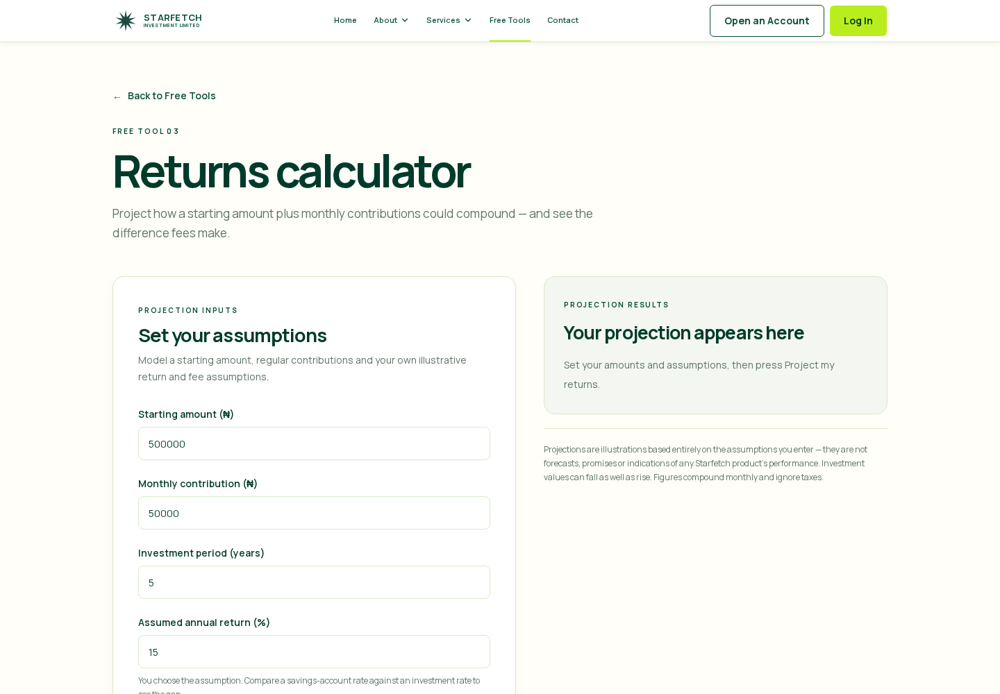
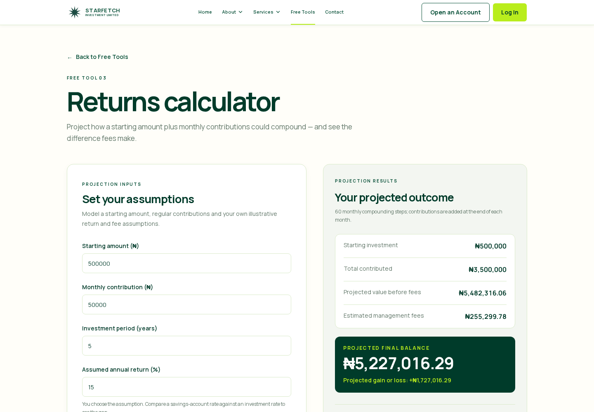

# Returns Calculator — Completion Report

**Status:** Complete and verified in the local production Next.js preview.

## 1. Files created

- `app/tools/returns/page.tsx` — public Returns Calculator route, local Back to Free Tools navigation, metadata, and shared Navbar/Footer.
- `components/tools/ReturnsCalculator.tsx` — accessible, local-only calculator form and initial/calculated results panels.
- `lib/tools/returns.ts` — validation, monthly-compounding projection model, monthly fee model, and Naira presentation helpers.
- `scripts/returns-calculator-check.ts` — deterministic projection, validation, navigation/privacy source checks.
- `artifacts/returns-calculator-before.png` — production-browser screenshot before calculation.
- `artifacts/returns-calculator-after.png` — production-browser screenshot after calculation.

## 2. Files modified

- `app/tools/page.tsx` — only Tool 03 now links locally to `/tools/returns`; Tool 02 remains unavailable.
- `components/Navbar.tsx` — Free Tools is now active for `/tools` and its calculator subroutes, including `/tools/returns`.
- `components/auth/AuthProvider.tsx` — added `/tools/returns` to the existing local-only public calculator session-refresh bypass. This prevents a direct public calculator visit from making the otherwise global auth-refresh request; no backend/auth-service behavior, endpoints, credentials, or authorization rules were changed.
- `scripts/tools-page-check.ts` — now verifies both Budget Planner and Returns Calculator local links and the single unavailable Portfolio Allocation Tool state.
- `package.json` — added `test:returns-calculator`.

## 3. Implementation summary

- Added the public, login-free `/tools/returns` page using the existing Starfetch visual system: ivory background, white form card, pale-green results panel, forest-green typography, subtle borders, rounded corners and lime action button.
- The form uses the exact requested visible labels and default values:
  - Starting amount (₦): `500000`
  - Monthly contribution (₦): `50000`
  - Investment period (years): `5`
  - Assumed annual return (%): `15`
  - Annual management fee (%): `1.5`
- Tool 03 on `/tools` is a local Next `Link`; neither route points to the legacy website.
- No other Free Tool was implemented or altered functionally.

## 4. Calculation methodology and formulas

All monetary inputs are parsed as integer kobo. Projection values remain unrounded internally and are rounded only when displayed.

Let:

- `S` = starting amount
- `C` = monthly contribution
- `R` = user-entered annual return percentage
- `F` = user-entered annual management fee percentage
- `m` = whole number of monthly time steps

The model uses a nominal annual return compounded monthly:

```text
monthly return rate = R / 1200
monthly fee rate    = F / 1200
```

For each month, with contributions added **at the end of the month**:

```text
Gross(t) = Gross(t−1) × (1 + R / 1200) + C
Net(t)   = Net(t−1) × (1 + R / 1200) × (1 − F / 1200) + C
```

Derived figures:

```text
Total contributed          = S + (C × m)
Projected value before fees = Gross(m)
Estimated management fees   = Gross(m) − Net(m)
Projected final balance     = Net(m)
Projected gain or loss      = Net(m) − Total contributed
```

The fee is therefore applied monthly to each month’s return-evolved balance; it is **not** subtracted once from the final value. Taxes are deliberately excluded, as stated in the on-page disclaimer.

## 5. Validation behavior

- Starting amount and monthly contribution are required, non-negative Naira values with up to two decimals.
- Investment period is required, greater than zero, capped at 100 years, and must resolve to a whole number of months (for example, `1.5` years is 18 months).
- Annual return accepts illustrative negative, zero and positive assumptions from `-99.99%` to `1000%`.
- Annual management fee is required, non-negative and capped at `100%` so its monthly charge remains mathematically stable.
- Scientific notation, NaN/Infinity-like values, incomplete values, invalid precision and unsafe projected balances are rejected with accessible field or form errors.
- Input values are retained for correction; no invalid number is silently replaced.

## 6. Results panel

**Before calculation:** shows the exact requested instructional heading and supporting copy without fabricated figures.

**After calculation:** displays starting investment, total contributed, projected value before fees, estimated management fees, visually prominent projected final balance, gain/loss (including negative outcomes), and a simple Starfetch-coloured growth breakdown for starting amount, additional contributions, gain/loss and final balance.

The exact required disclaimer stays visible beneath the panel before and after calculation:

> Projections are illustrations based entirely on the assumptions you enter — they are not forecasts, promises or indications of any Starfetch product's performance. Investment values can fall as well as rise. Figures compound monthly and ignore taxes.

## 7. Currency formatting

All amounts use Naira (`₦`) with grouping separators. Kobo is shown only where necessary, such as `₦5,482,316.06`. Projection calculations retain precision and output rounding is limited to the final displayed kobo value.

## 8. Verified calculation cases

The source regression test and production-browser verification covered:

1. Default values: total contributed **₦3,500,000**, gross **₦5,482,316.06**, fee impact **₦255,299.78**, final balance **₦5,227,016.29**, gain **₦1,727,016.29**.
2. Starting amount only with zero monthly contributions.
3. Monthly contributions with a zero starting amount.
4. Zero annual return.
5. Negative annual return and an explicitly displayed loss.
6. Zero management fee, where gross and net values are equal and fee impact is ₦0.
7. Higher management fee, which reduces final balance.
8. One-year and 30-year investment periods.
9. Invalid negative amount/fee, out-of-range annual return and non-whole-month period validation.
10. Recalculation after changing monthly contribution.
11. Total-contribution calculation.
12. Monthly fee-impact calculation.

## 9. Responsive and navigation verification

Production-browser checks passed at:

| Width | Verified layout |
| --- | --- |
| 1440px | Two columns, no horizontal overflow |
| 1024px | Two columns, no horizontal overflow |
| 768px | Form above results, no horizontal overflow |
| 390px | Form above results, no horizontal overflow |
| 320px | Form above results, no horizontal overflow |

Also verified:

- Tool 03 on `/tools` navigates to `/tools/returns` through a Next `Link`.
- Back to Free Tools navigates locally to `/tools`.
- The Free Tools Navbar item is active on `/tools/returns`.
- Direct production loading and calculation made no `/api` request, storage write or financial-value transmission.

## 10. Build and regression results

- `npm run typecheck` — passed.
- `npm run build` — passed; `/tools/returns` is statically generated.
- `npm run test:returns-calculator` — passed.
- Existing Budget Planner, Free Tools, Footer, Privacy, Complaints, safe auth-navigation, Joint contract and Joint UI isolation checks — passed.
- Production Next preview is running on port 3000.

## 11. Browser screenshots

### Before calculation



### After calculation



## 12. Remaining limitations

- This is a deterministic illustration only: it uses constant user-entered rates, monthly compounding and ignores taxes. It does not model variable market performance, withdrawals, tax rules, product-specific fees, actual Starfetch returns or investment suitability.
- It intentionally does not save, email, transmit or execute the scenario.
- It accepts only investment periods that map exactly to full monthly time steps, which keeps the stated monthly model explicit and avoids undisclosed partial-month assumptions.

## 13. Backend confirmation

No NestJS backend, Prisma, PostgreSQL, API endpoint, migration, deployment, investor-portal or Admin-Portal file was modified. No Git commit, push, merge, PR or remote repository change was made.
